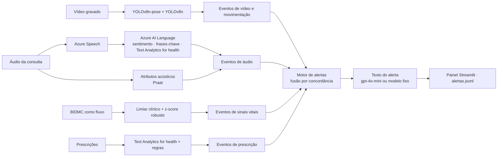

# Monitoramento Multimodal de Pacientes

Tech Challenge — Fase 4 (FIAP Pós Tech, IA para Devs).

Uma central de monitoramento que recebe **vídeo** do quarto e da fisioterapia, **áudio** de consultas, **sinais vitais** e **prescrições** de pacientes internados, transforma cada fonte em **eventos** com horário e evidência, e alerta a equipe médica. O alerta sobe para **crítico** quando duas modalidades independentes apontam para o mesmo paciente na mesma janela de tempo.

O sistema **não diagnostica**: sinaliza um desvio com a evidência e deixa a decisão para a equipe.

> **Sem chave de nuvem, tudo roda.** Os clientes do Azure e da OpenAI têm modo simulado. Toda resposta real fica gravada em `docs/execucoes_gravadas/` e é reaproveitada quando a chave não existe. Cada resultado diz a sua origem: `real`, `gravado` ou `simulado`.

## Fluxo



| Fonte | O que detecta | Como |
|---|---|---|
| Vídeo (quarto) | Queda, saída do leito, imobilidade prolongada, agitação | Pose (17 pontos) e leito detectados por YOLOv8 em CPU; regras geométricas sobre tronco, quadril e zona do leito |
| Vídeo (fisioterapia) | Repetições e amplitude insuficiente | Ângulo da articulação do exercício com máquina de estados |
| Áudio | Termos críticos, sentimento negativo, alteração vocal | Azure Speech (pt-BR, horário por palavra) → Azure AI Language; voz comparada com a referência do próprio paciente (taxa de fala, pausas, F0, energia, jitter, shimmer, HNR) |
| Sinais vitais | SpO2, FC, FR (e PA) fora da faixa ou com mudança brusca | Faixas no estilo NEWS2 com persistência mínima + z-score robusto em janela móvel só do passado |
| Prescrições | Dose excessiva, dose fora da faixa, via incompatível, suspensão abrupta, duplicidade de classe | Regras sobre a linha do tempo; medicamento, dose, via e frequência extraídos do texto livre pelo Text Analytics for health |

**Fusão.** Todo módulo produz o mesmo objeto `Evento` (`src/monitor/eventos.py`). O motor de alertas (`src/monitor/alertas/`) dá um alerta por evento, pela regra de maior prioridade: **concordância** (eventos de severidade alta de duas ou mais *modalidades* no mesmo paciente em 10 min) > severidade máxima > severidade alta > informativo. Queda e saída do leito vêm da mesma câmera, então não concordam entre si.

## Instalação

Python 3.11, Windows ou Linux, sem GPU.

```bash
python -m venv .venv
.venv/Scripts/activate            # Linux: source .venv/bin/activate
pip install --index-url https://download.pytorch.org/whl/cpu torch==2.15.0 torchvision
pip install -r requirements.txt
pip install -e .
python scripts/check_env.py       # sai com 0 quando o ambiente está pronto
```

Dados públicos:

```bash
python scripts/baixar_bidmc.py    # 53 gravações do BIDMC (PhysioNet, acesso aberto)
python scripts/baixar_quedas.py   # 3 clipes do UR Fall Detection Dataset (CC BY-NC-SA 4.0)
```

Os pesos do YOLOv8 (`models/`) baixam sozinhos no primeiro uso.

### Chaves (opcional)

Copie `.env.example` para `.env` e preencha:

| Variável | Serviço |
|---|---|
| `AZURE_SPEECH_KEY`, `AZURE_SPEECH_REGION` | Azure AI Speech (fala para texto) |
| `AZURE_LANGUAGE_KEY`, `AZURE_LANGUAGE_ENDPOINT` | Azure AI Language (sentimento, frases-chave, Text Analytics for health) |
| `OPENAI_API_KEY`, `OPENAI_MODEL` | Texto dos alertas e do relatório da sessão; Whisper como linha de base da transcrição |

`MONITOR_MODO_NUVEM` escolhe o comportamento: `auto` (padrão: real quando a chave existe), `real` (falha sem chave) ou `simulado` (nunca chama a rede).

## Uso

### Cenário de ponta a ponta e painel

```bash
python -m experiments.run_cenario       # todas as fontes de data/cenario.json → results/alertas.jsonl
streamlit run app/painel.py             # painel; o botão "Reproduzir cenário" roda o mesmo comando
```

`data/cenario.json` descreve três pacientes. O `leito-12` é o caso central: a SpO2 cai às 14:02, o paciente relata falta de ar às 14:03 (alerta crítico por concordância entre áudio e sinais vitais) e cai no quarto às 14:04 (concordância de três modalidades). Cada fonte aceita uma lista de arquivos e usa o primeiro que existir: a gravação do grupo em `data/gravacoes/`, senão a amostra sintética ou o clipe público. Fonte sem arquivo é pulada com aviso.

### Cada fonte separada

```bash
python -m experiments.run_sinais --gravacao 1 --paciente leito-12 --inicio 2026-11-12T14:00:00 --plantar queda_spo2@120
python -m experiments.run_video --video data/raw/urfall/fall-10-cam0.mp4 --cenario quarto --paciente leito-12
python -m experiments.run_video --video data/gravacoes/V2.mp4 --cenario fisioterapia --exercicio elevacao_lateral
python -m experiments.run_audio --audio data/amostras/audio/sintetico_alterado.wav --referencia data/amostras/audio/sintetico_normal.wav
python -m experiments.run_prescricoes --pacientes 8 --dias 10
python -m experiments.run_alertas       # junta results/eventos/*.jsonl
```

### Avaliação

```bash
python -m experiments.run_avaliacao     # → results/resultados.json (todas as tabelas do relatório)
```

| Fonte | Como é medida |
|---|---|
| Sinais vitais | Anomalias plantadas com posição conhecida nas 53 gravações do BIDMC: recall, precisão, F1, atraso; eventos por hora nas séries sem plantio |
| Vídeo | Eventos anotados por clipe (tolerância de ±2 s): sensibilidade e falsos positivos |
| Áudio | Alteração vocal e termos críticos contra gabarito; WER do Azure × Whisper quando há transcrição real |
| Prescrições | Anomalias plantadas: recall, precisão, F1; acerto da extração do texto livre |
| Cenário | Tempo entre o primeiro evento e o alerta crítico por concordância |

## Testes

```bash
pytest -q             # rápidos, sem rede e sem modelo
pytest -q -m lento    # YOLOv8 em vídeo real
pytest -q -m nuvem    # serviços reais (exige chave)
```

## Estrutura

```text
src/monitor/
  eventos.py          contrato Evento / Alerta
  config.py           caminhos, credenciais, modo da nuvem
  nuvem/              Azure Speech, Azure AI Language, OpenAI (modo simulado e respostas gravadas)
  sinais/             BIDMC, fluxo, detectores, anomalias plantadas, avaliação
  video/              leitura, inferência YOLOv8 (com cache), fisioterapia, quarto, anotação, relatório
  movimentacao/       série de movimentação e eventos de leito/imobilidade/agitação
  audio/              conversão, transcrição, termos críticos, atributos acústicos, WER
  prescricoes/        gerador sintético, extração, regras
  alertas/            motor com fusão, texto do alerta, saída
  cenario.py          orquestração de ponta a ponta
experiments/          entradas executáveis (python -m experiments.run_*)
app/painel.py         painel Streamlit
scripts/              check_env, downloads, geração de áudio sintético
specs/                visão, roadmap, estado e uma spec por feature
data/cenario.json     cenário de demonstração
data/amostras/        amostras pequenas versionadas (áudio sintético, prescrições)
docs/execucoes_gravadas/  respostas reais gravadas dos serviços de nuvem
```

## Dados e limites

- **BIDMC PPG and Respiration** (PhysioNet, acesso aberto): sinais de pacientes de UTI a 1 Hz. Não tem pressão arterial; a PA é sintética e marcada como tal quando usada.
- **UR Fall Detection Dataset** (CC BY-NC-SA 4.0): clipes de queda usados para avaliar o vídeo enquanto as gravações do grupo não chegam. Os clipes terminam pouco depois da queda, o que limita a confirmação de permanência no chão.
- **Áudio sintético** (voz Microsoft Maria, pt-BR) em `data/amostras/audio/`: serve para o fluxo rodar. A voz sintética não tem a variação de jitter e shimmer de uma voz humana; a alteração das amostras vem de taxa de fala e pausas.
- **Prescrições sintéticas** com catálogo didático, **não é referência clínica**. Precisão 1,0 nelas mede consistência entre o que foi plantado e o que é detectado, não generalização.
- **Vídeos e áudios encenados pelo grupo**, com consentimento (LGPD: dado de saúde é dado sensível). Nenhum dado real de paciente é usado.
- **Fora do escopo:** vídeo de cirurgia (sem dado público viável), OpenPose (exige GPU; o YOLOv8-pose faz a mesma tarefa), PhysioNet credenciado (MIMIC), AudioSet (não tem voz de paciente) e treino de modelo próprio.
