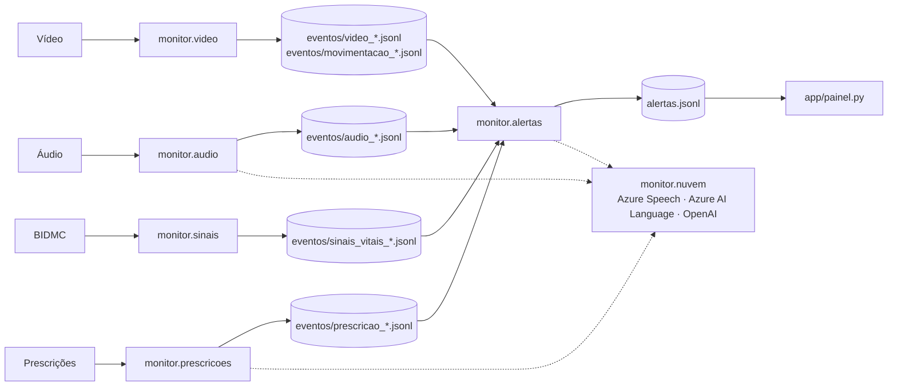

# Fundação — arquitetura e convenções (vale para todas as features)

**Status:** implementada (`746e8ba`). Este documento é a referência que toda feature segue.

## Fluxo

## Contrato (`src/monitor/eventos.py`)

- **`Evento`**: `paciente_id`, `instante` (datetime ingênuo, horário do fato), `fonte` (`Fonte`), `tipo` (snake_case, ex.: `queda`), `severidade` (`Severidade.INFO|ALTA|MAXIMA`), `descricao` (frase em português, legível pela equipe), `detector` (`nome/v1`), `valor` (número que disparou), `evidencia` (dict de string → caminho relativo à raiz ou texto curto).
- **`Modalidade`**: a fusão conta modalidades. `VIDEO` e `MOVIMENTACAO` são a mesma câmera.
- **`Alerta`**: `nivel` (`NivelAlerta`), `regra`, `eventos`, `texto`, `texto_origem`.
- **E/S**: `salvar_jsonl`, `carregar_eventos`, `carregar_alertas`.

## Nuvem (`src/monitor/nuvem/`)

| Cliente | Métodos | Simulado |
|---|---|---|
| `ClienteFala` | `transcrever(wav, idioma="pt-BR") -> Transcricao` (palavras com `inicio_s`/`fim_s`) | Texto do arquivo irmão `<audio>.txt`, palavras uniformes na duração |
| `ClienteLinguagem` | `analisar(texto) -> AnaliseTexto` (sentimento por frase, frases-chave, entidades de saúde); `entidades_saude(texto) -> (entidades, origem)` | `monitor.nuvem.lexico` |
| `ClienteLLM` | `redigir(instrucoes, dados, modelo_fixo) -> Redacao`; `transcrever_whisper(audio) -> Transcricao \| None` | `modelo_fixo(dados)`; Whisper devolve `None` |

Toda resposta real é gravada em `docs/execucoes_gravadas/<servico>/<hash>.json`; sem chave, a gravação da mesma entrada é reaproveitada (`origem="gravado"`). Toda saída carrega `origem` (`real|gravado|simulado`), e o painel e o relatório mostram isso.

## Convenções

1. **Português** em nomes de módulo, função, variável e mensagem. Termos técnicos consagrados ficam em inglês (`z-score`, `frame` só em comentário).
2. **Detector é função pura ou classe sem E/S**: recebe arrays/dataclasses, devolve `list[Evento]`. Leitura de arquivo, modelo YOLO e rede ficam em módulos separados. É o que deixa testar com dado feito à mão.
3. **Parâmetros** num `config.py` do próprio subpacote, como `@dataclass(frozen=True)` com valor padrão documentado (unidade e motivo). Nada de número mágico no detector.
4. **Entrada executável** em `experiments/run_<feature>.py` (`argparse`, `python -m experiments.run_<feature>`). Grava Eventos em `results/eventos/<fonte>_<paciente>.jsonl` e evidências em `results/evidencias/...`. Caminhos de evidência relativos à raiz do repo.
5. **Testes** em `tests/<feature>/test_*.py`. Teste padrão roda em segundos, sem rede e sem YOLO. O que carrega modelo ou mídia real leva `@pytest.mark.lento`; o que chama serviço real leva `@pytest.mark.nuvem`.
6. **Determinismo**: `monitor.config.SEMENTE` em todo gerador aleatório.
7. **Tipos** em toda assinatura pública; `from __future__ import annotations`.
8. **Sem dependência nova** fora do `requirements.txt` sem registrar em `specs/project/STATE.md`.
9. **Avaliação**: cada feature expõe `monitor.<feature>.avaliacao.avaliar(...) -> dict` com números prontos para o `results/resultados.json`.

## Ambiente

- `.venv` com Python 3.11, torch CPU. `python scripts/check_env.py` sai com 0 quando está tudo pronto.
- `pytest` (rápido) · `pytest -m lento` (modelos e mídia) · `pytest -m nuvem` (serviço real).
- Pesos YOLO em `models/` (baixam no primeiro uso; fora do git).
